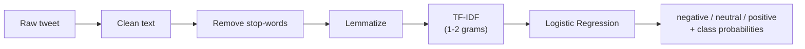
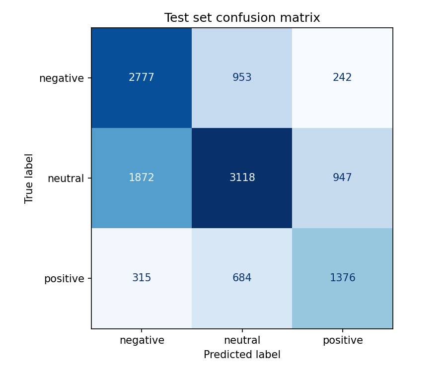

<div align="center">

# 💬 NLP Sentiment Classifier

**Classify tweets as _negative_, _neutral_ or _positive_ using NLTK, TF-IDF and Logistic Regression.**


</div>

---

## 📑 Table of Contents

- [Overview](#-overview)
- [Pipeline](#-pipeline)
- [Quick Start](#-quick-start)
- [Usage](#-usage)
- [Dataset](#-dataset)
- [Results](#-results)
- [Limitations](#-limitations)
- [Project Structure](#-project-structure)
- [Tech Stack](#-tech-stack)

---

## 🔎 Overview

This project is a complete, reproducible **three-class sentiment classifier** for short, noisy social-media text.
It covers the whole workflow: downloading data, cleaning text, extracting features, tuning and training a
model, evaluating it honestly on a held-out test set, and predicting sentiment for your own sentences.

**Highlights**

- 🧹 Tweet-aware preprocessing: URL and `@mention` removal, contraction expansion, stop-word removal and lemmatization.
- ⚖️ Handles class imbalance with balanced class weights, selected through validation-set tuning.
- 🧪 Clean evaluation: hyper-parameters are chosen on the validation set; the test set is used **once**.
- 📊 Reports precision, recall, F1 and a confusion matrix, all saved to `results/`.
- ⌨️ A command-line tool that returns the predicted label with a probability for every class.
- ✅ Unit tests for preprocessing and prediction.

---

## 🛠 Pipeline



| Step | Details |
|------|---------|
| **1. Clean** | Lowercase; remove URLs and `@mentions`; expand contractions (`don't` → `do not`, `can't` → `can not`); keep letters only (drops `#`, digits, punctuation, emojis). |
| **2. Stop-words** | Remove NLTK's English stop-words, **except negations** (`no`, `nor`, `not`, `never`, `cannot`) because they flip sentiment. |
| **3. Lemmatize** | WordNet lemmatizer, applied as verb then noun (`running` → `run`, `cats` → `cat`). |
| **4. Features** | `TfidfVectorizer` with unigrams + bigrams, `min_df=2`, sublinear term frequency. |
| **5. Model** | `LogisticRegression` (`max_iter=1000`). `C` and `class_weight` tuned on the validation set by macro-F1. |

**Preprocessing example**

| Input | Output |
|-------|--------|
| `I don't like it` | `not like` |
| `Ben Smith (concussion) remains out of the lineup Thursday` | `ben smith concussion remain lineup thursday` |

---

## 🚀 Quick Start

```bash
# 1. Create and activate a virtual environment
python -m venv .venv
.venv\Scripts\activate          # Windows
# source .venv/bin/activate     # macOS / Linux

# 2. Install dependencies
pip install -r requirements.txt

# 3. Download data, train and evaluate
python download_dataset.py
python train_model.py
```

NLTK resources (`stopwords`, `wordnet`) are downloaded automatically on first run.

---

## 💻 Usage

**Classify text from the command line**

```bash
python predict.py "I love this phone, it works great!" "The meeting is scheduled for Tuesday at 3pm."
```

**Interactive mode** (run without arguments; press Enter on an empty line to quit)

```bash
python predict.py
```

**Real output from the trained model**

| Text | Prediction | Probabilities (neg / neu / pos) |
|------|------------|----------------------------------|
| I love this phone, it works great! | **positive** | 0.4% / 0.1% / 99.5% |
| Worst service ever, I will never come back. | **negative** | 96.8% / 1.8% / 1.4% |
| The meeting is scheduled for Tuesday at 3pm. | **neutral** | 2.2% / 85.1% / 12.7% |
| not good at all | **negative** | 97.9% / 0.2% / 1.9% |

**Run the tests**

```bash
python -m pytest
```

---

## 🗂 Dataset

[TweetEval (sentiment)](https://huggingface.co/datasets/cardiffnlp/tweet_eval) from Cardiff NLP, downloaded
through the Hugging Face `datasets` library and saved as CSV in `data/` (not tracked by Git).

| Split | Tweets | Negative | Neutral | Positive |
|-------|-------:|---------:|--------:|---------:|
| Train | 45,615 | 7,093 | 20,673 | 17,849 |
| Validation | 2,000 | 312 | 869 | 819 |
| Test | 12,284 | 3,972 | 5,937 | 2,375 |

> The classes are imbalanced, and the test set has a noticeably larger share of negative tweets (~32%)
> than the training set (~16%).

---

## 📈 Results

### Hyper-parameter search (validation macro-F1)

| C | `class_weight = none` | `class_weight = balanced` |
|---|----------------------:|--------------------------:|
| 0.5 | 0.5982 | 0.6363 |
| 1 | 0.6201 | 0.6387 |
| **2** | 0.6299 | **0.6443** ✅ |
| 5 | 0.6250 | 0.6338 |

Balanced class weights beat unweighted training at every value of `C`.

### Final test-set performance

Model: `C = 2`, `class_weight = "balanced"`, evaluated once on 12,284 unseen tweets.

| Class | Precision | Recall | F1 | Support |
|-------|----------:|-------:|---:|--------:|
| negative | 0.5594 | 0.6991 | 0.6215 | 3,972 |
| neutral | 0.6557 | 0.5252 | 0.5832 | 5,937 |
| positive | 0.5365 | 0.5794 | 0.5571 | 2,375 |

| Metric | Score |
|--------|------:|
| Accuracy | 0.5919 |
| Macro-F1 | 0.5873 |
| Weighted-F1 | 0.5906 |

### Confusion matrix



| True \ Predicted | negative | neutral | positive |
|------------------|---------:|--------:|---------:|
| **negative** | 2,777 | 953 | 242 |
| **neutral** | 1,872 | 3,118 | 947 |
| **positive** | 315 | 684 | 1,376 |

**Reading the results**

- Negative tweets are found most reliably (recall 0.70), helped by the balanced class weights.
- **Neutral is the hardest class:** 1,872 of 5,937 neutral tweets were predicted as negative. Neutral
  tweets are often short, factual or ambiguous, with few strong sentiment words.
- Test scores are lower than validation scores (macro-F1 0.587 vs 0.644), consistent with the
  different class mix in the test set.

Raw numbers: [`results/metrics.json`](results/metrics.json) and
[`results/classification_report.txt`](results/classification_report.txt).

---

## ⚠️ Limitations

- A bag-of-words model cannot capture **sarcasm, irony or long-range context**.
- **Emojis are discarded** during preprocessing, which loses some sentiment signal.
- Hashtags are kept as single tokens (`#HappyBirthday` → `happybirthday`), not split into words.
- This is a classical baseline. Fine-tuned transformer models are expected to score higher on this benchmark.

**Ideas for improvement:** keep or translate emojis, split hashtags, try linear SVM or other
classifiers, and compare with pre-trained embeddings or transformer models.

---

## 📁 Project Structure

```
NLP-Sentiment-Classifier/
├── download_dataset.py     # fetch TweetEval into data/
├── preprocessing.py        # cleaning, stop-word removal, lemmatization
├── train_model.py          # tuning, training, evaluation, saving
├── predict.py              # command-line prediction
├── requirements.txt        # pinned dependencies
├── data/                   # downloaded dataset (not tracked)
├── models/
│   └── sentiment_model.joblib
├── results/
│   ├── metrics.json
│   ├── classification_report.txt
│   └── confusion_matrix.png
└── tests/
    ├── test_preprocessing.py
    └── test_predict.py
```

---

## 🧰 Tech Stack

Python 3.10 · scikit-learn · NLTK · pandas · NumPy · Hugging Face `datasets` · Matplotlib · joblib · pytest
